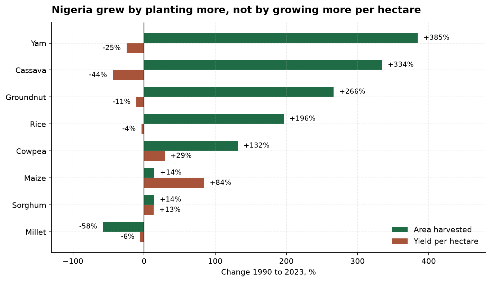
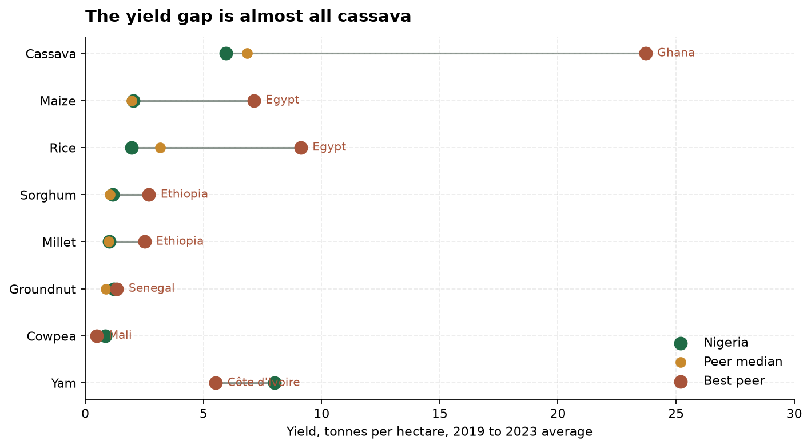

# Nigeria Yield Gap

**Live dashboard: https://REPLACE-WITH-YOUR-LINK.streamlit.app**

Nigeria's output of eight staple crops grew 149% between
1990 and 2023. I wanted to know where that growth came
from, whether it kept up with the population, and how Nigerian yields compare with other
countries.



## What I found

**The growth came from land, not from better farming.**
128% of it came from planting more. Yield pulled the other
way at -28%. Maize is the exception, with yield up
84% on 14% more land.

**Food per person peaked in 2006.**
543 kg in 1990, 792 kg
at the peak, 709 kg in 2024. The line is bumpy and 2018
came within 3% of the peak, so I would say it stopped improving rather than collapsed.
Clearing more land stopped keeping up with population growth.

**Nigeria is not broadly behind. The gap is cassava.**
It beats the peer median on 6 of 8
crops and leads on cowpea and yam. But cassava, its
biggest crop by area, yields 5.9 t/ha against 23.7 in
Ghana. That one crop is 70% of the gap.



**Fertilizer explains less of it than I expected.**
Nigeria uses 16 kg/ha against Ghana's 37 and Egypt's
577. A fixed effects regression across 178 countries puts the
elasticity at 0.086, and 0.051 for low input
countries like Nigeria. So 10% more fertilizer goes with about
0.5% more yield.

The effect is bigger where input use is already high (0.125)
than where it is low (0.051), which suggests fertilizer needs
the rest of the system with it.

## How I did it

**Three year averages at each end.** Using single years moves the headline between
150% and 177% depending on which
years I pick.

**Logs for the split.** Production is area times yield, so part of the growth belongs to
both at once. Applying the land change first gives 163.8%,
applying the yield change first gives 110.0%, and that
shared part is 54% of the total. Logs turn
the multiplication into an addition, which has no order.

**Yield worked out from production and area** rather than taken from the published
column, then checked against it. They agree to within 0.4%.

**Peers have to be a real size.** A country only counts for a crop if it farms at least
10% as much of it as Nigeria. Without that, Niger sets the
cassava target on 23,000 hectares against Nigeria's 9.9 million.

**The model** is two way fixed effects OLS, 9,466 rows, 178
countries, errors clustered by country. Without fixed effects it looks like
0.232.

## Limits

- A lot of the Nigerian data is estimated rather than measured, so long run trends mean
  something but single years do not.
- The 10% peer cut-off is a judgement. It is in `src/config.py`
  so it can be changed.
- The fertilizer results are associations, not causes.
- A gradient boosting model scored 0.887 against
  0.882 for just assuming each country stays where it was. Barely
  worth it, and I say so.
- Egypt and South Africa are in to show the best case, not as a target.
- These are national averages, which hide a lot in a country this size.

`NOTES.md` has the things that went wrong along the way.

## Running it

```bash
python -m venv .venv
.venv\Scripts\activate
pip install -r requirements-dev.txt
```

Run the notebooks in order, 01 to 06. The raw data downloads itself.

```bash
pytest -q
streamlit run app.py
```

Delete `data/processed/` and `outputs/` and rerun, and everything comes back.

## Files

```
app.py                    dashboard
src/config.py             all the settings
src/io_utils.py           downloading and loading
notebooks/
  01_data_prep            raw FAOSTAT to a clean panel
  02_context              population and fertilizer
  03_analysis             growth split and yield gap
  04_model                fixed effects regression
  05_machine_learning     how predictable is any of this
  06_figures              the charts
tests/test_pipeline.py    18 checks on the output
data/raw/                 downloads here, not committed
data/processed/           committed
outputs/figures/
```

Settings live in `src/config.py`: the crops, the countries, the year window, the peer
cut-off, the yield bounds. The notebooks write their headline numbers to JSON and the
dashboard and this README read from there, so nothing is typed twice.

## Data

FAOSTAT Production Crops and Livestock (Africa) and World Bank WDI. 8 crops, 15
countries, 1961 to 2024. See `data/raw/SOURCES.md`.

---

**Halimat H. Fakorede** · agriculture graduate working in data ·
[LinkedIn](https://linkedin.com/in/halimatfakorede) · fakoredehalimat1@gmail.com
